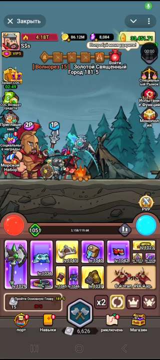
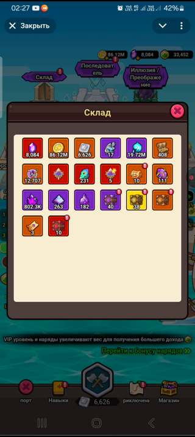

# TERRITORY 2.0 — видеоатлас, визуальный аудит и точное ТЗ
**Дата:** 24 октября 2026 · **Источник:** запись экрана, присланная владельцем в чате (4:05, 720×1616, H.264), + отдельный скриншот текущего TERRITORY 2.0 (689×1536).

**Статус:** разобрано покадрово с контрольными выборками через 2 секунды (122 кадра); 6 ключевых кадров ниже. Это дополнение к утверждённому ТЗ, **не его замена**.

## 0. Приоритет источников (ОБЯЗАТЕЛЬНО)
1. **ВНЕШНИЙ ВИД главного экрана TERRITORY 2.0:** единственный утверждённый владельцем 24.10.2026 оригинал [TERRITORY_2_0_APPROVED_2026-10-24.jpg](../reference/TERRITORY_2_0_APPROVED_2026-10-24.jpg) и [замороженный стандарт](../TERRITORY_2_0_APPROVED_UI_LOCK_RU.md). **Ни видео, ни текущая тестовая сборка не могут отменить утверждённые пропорции.**
2. **Видео владельца:** образец глубины разделов, логики переходов, состояний окон, обратной связи, контрастности, иллюстрированных карточек и микроанимаций. Отображаемые цифры, товары, вероятности, цены и чужие иллюстрации не являются утверждённой экономикой TERRITORY.
3. **Скрин тестируемой V2-сборки владельца:** фото багов и несоответствий. Это **антиэталон**.
4. **Данные и формулы:** отдельное Master ТЗ, реестр неизвестных параметров и утверждённые серверные механики; не выводить честные шансы и цены из видео.

Нельзя копировать игровые активы сторонней игры в релиз TERRITORY. Низкоразрешённые кадры из видеозаписи используются только как иллюстрированные комментарии к техническому аудиту.

## 1. Видео — индекс экранов/действий, в хронологическом порядке

| Таймкод, с | Наблюдаемое окно / поведение | Что реализовать **своими** ресурсами в V2 |
|---|---|---|
| 00–04 | Главный PvE, маршрут из 5 узлов, герой и противник, полоса орбов, две строки лута и 5 нижних кнопок | Достоверное HUD-состояние, автоматический бой без блокировки тапов, маршрутизатор |
| 04–10 | Загрузка и яркое окно «Получено»; много иконок наград и падающих монет | Слои результата: визуальный дроп, перечень предметов, кнопки просмотра; не повторять выдачу по закрытию |
| 10–14 | Результаты/история и окно «Склад» | Предыдущие награды, время/тип события, возврат на тот же экран |
| 14–44 | Склад с цветными группами ресурсов; долгий просмотр подсказок по нажатию | Ячейка → всплывающее описание/тип/редкость/источник/назначение; вкладки по категории |
| 16–24 | Подсказки «Алмаз», «Золото», боевой камень, магический ключ, обломки души | Общий компонент tooltip: название, количество, назначение и действия |
| 26–42 | Предметы для улучшения, рунические/материальные осколки, рудные элементы | Не смешивать добычу, валюту, материал, расходник и экипировку в одной безымянной сетке |
| 32–34 | Детали предмета с изображением, прогрессом и действием улучшения | Модальное окно предмета: текущий ранг, рецепт, дефицит, подтверждение |
| 46–52 | Набор/ящик с несколькими вариантами выбора награды | Экран выбора одного предмета, точные требования и понятная кнопка; исключительно демо/сервер-валидированные заявки |
| 54–58 | Переход в море/порт, завершение плавания, новое состояние с центральным объектом | Для Порта отдельный визуальный сценарий и эффект сбора, не текстовая заглушка |
| 58–64 | «Последователь»: большой главный босс и сетка доступных спутников/юнитов | Выбор спутника, роли, ранг, уровни, доступность и состав отряда |
| 66–70 | «Призыв» с алтарём, полоса прогресса, слоты, затем диалог подтверждения | Призыв: превью содержимого и шансов только если подтверждены, состояние «нет валюты» |
| 76–82 | «Тёмная Энергия»: выделенный персонаж, круговая система слотов, сетка ниже | Два иерархических уровня: активный персонаж с окружением слотов; коллекция элементов |
| 84–118 | «Драгоценный камень»: сокеты, три камня в ряду, таблица ниже, синтез | Многоступенчатая сборка/синтез; выбранное гнездо, тип и редкость камня; без кликов сквозь окно |
| 94–106 | Область с выбором/описанием камня и списком свойств | Прозрачное окно качеств: бонус по классу, число имеющихся, состояния кнопок |
| 120–128 | Возврат в порт, затем в основное окно автобоя без потери боевого состояния | Переходы обратно без сброса таймера/текущей страницы |
| 130–148 | «Почта»: список писем, подробное письмо, две награды, «Получено», массовые действия | Письмо → детали → однократное получение, отметка прочтения, страница и «забрать всё» |
| 150–154 | «Ежедневные задания» и «Еженедельная награда» с линейкой прогресса | Прогресс-карточки, чекбоксы, получение награды и период сброса по ТЗ |
| 156–160 | «Путь Героя»: награда за ступени прогресса | Длинная скроллируемая траектория с этапами, прошлые/будущие награды |
| 164–168 | «Трактат опыта»: награды по уровням | Вертикальный путь, текущий уровень, доступные и заблокированные ступени |
| 170–178 | «Супервыполнимый фонд»: категории фондов и списки наград | Ясная группировка, состояния «доступно/получено/закрыто» |
| 180–184 | «Благословение» и «Почётные звания» с диаграммами и отдельными карточками | Боевые бонусы визуально и текстом, древо привилегий, условия активации |
| 188–192 | «Автобой»: модальное окно с параметрами и кнопкой «Сохранить» | Настройки автофарма: переключатели, ограничения, сохранение, возврат без потери состояния |
| 194–204 | «Приключение»: скроллируемая карта регионов, выбор босса и карточка наград | Большая рисованная карта, стадии с боссами, требования, рекорды и вход |
| 206–208 | Тёмный зал подземелья: выбранное испытание и выбор очередного этапа | Особая локация и отдельный набор этапов, не копировать карту кампании |
| 210–220 | «Битва с боссом»: экран босса, «Таблица лидеров», детали игрока | Босс → награда за первое/повторное прохождение → рейтинг → персонаж → назад |
| 224–230 | «Навык»: иллюстрированное дерево из многоугольных ячеек и ряд пассивных навыков | Полноценная книга навыков, категории, активные и пассивные ячейки, статус изучения |
| 230–232 | «Подробности навыка»: большая панель, требования и действия | По нажатию отдельные сведения, уровни, ресурс улучшения, неподходящий класс/блокировки |
| 234–244 | Возврат в автобой; сильные удары, вспышки, численные эффекты и смена противника | Ясный боевой телеграф, шкала HP, атаки и анимация дропа без перекрытия основного UI |

**Не утверждать неподтверждённое:** незаметные при таком масштабе надписи, формулы, вероятность выпадения, валюта и цены остаются «требует подтверждения». Использовать видео для **системной архитектуры экранов**, а не для прямого копирования чужого IP.

## 2. Контрольные кадры из переданного видео

Каждый кадр — реальный стоп-кадр исходного пользовательского MP4, уменьшенный только для быстрого просмотра в репозитории. Держать исходное видео у владельца; не публиковать полный чужой игровой видеоконтент как наши активы.

| Точка | Превью | Назначение |
|---|---|---|
| 00:00 |  | PvE HUD, нижний лут, пять кнопок |
| 00:16 |  | Инвентарь, подсказка ресурса |
| 01:30 | Стоп-кадр в локальном наборе | Драгоценные камни и сокеты |
| 02:30 | Стоп-кадр в локальном наборе | Ежедневные задания |
| 03:16 | Стоп-кадр в локальном наборе | Карта и боссы |
| 03:46 | Стоп-кадр в локальном наборе | Иллюстрированное древо навыков |

**Примечание по загрузке:** первые два кадра сохранены прямо в GitHub. Для остальных четырёх точек ниже есть полный видеоразбор и извлечённые локальные кадры в отдельном проверочном архиве `territory_v2_reference_frames.zip` (передаётся владельцу в переписке); чтобы не показывать сломанные картинки, ссылки на ещё не загруженные бинарные файлы не выдаются за существующие. Дальнейшее извлечение дополнительных ключевых кадров производится только из оригинального видеоматериала.

## 3. Аудит тестовой TERRITORY 2.0 по скриншоту владельца 17:46
Текущий скрин: Android/Samsung, браузер, экран 689×1536, видимая игра по вертикали приблизительно от y≈137 до y≈1444. Скрин **не служит новым эталоном**.

| ID | Факт на присланном тестовом скрине | Требуемое исправление / проверка |
|---|---|---|
| V-001 🔴 | Слева подписи «Приглашение», «Социальные награды» и соседние накладываются друг на друга | Строгие пределы каждой ячейки, 2 строки максимум, без выхода за свою строку; названия не исчезают |
| V-002 🔴 | Крупные боковые иконки и длинные подписи не помещаются в семь равных зон | Подстраивать размер иконки и строки **по доступной высоте поля боя**, не растягивая фон |
| V-003 🔴 | Нижние Порт, Навыки, Приключение и Магазин выглядят разными по масштабу/рамке/свету | Единая шкала иллюстраций, размеры, выравнивание и подписи с фиксированным пространством |
| V-004 🔴 | Поднятая «БОЙ» слишком перетягивает и потенциально закрывает соседние подписи | Сохранить утверждённый синий шестигранник, уменьшить содержимое внутри безопасной формы |
| V-005 🟠 | Шкала этапов сверху сжата; заголовок и противник рядом с узлами читаются слабо | Читаемая подложка и корректный центр относительно кнопки «Войти» |
| V-006 🟠 | Главный экран слишком насыщен подписью к боковым иконкам на фоне боя | Выразительная обводка текста, правильные межстрочные интервалы, без перекрытия героев |
| V-007 🟠 | Верхняя шапка: длинный блок силы и три валюты рядом с профилем | Проверить места на ширинах 320/360/390/430 и читаемость сумм при росте чисел |
| V-008 🟠 | Круги HP/энергии: процент в маленьком верхнем окне и отдельный внутренний показатель | Запрет наложения процентов на HP/энергию; сохранить точную геометрию сфер оригинала |
| V-009 🟠 | Снаряжение: первый огромный предмет, остальные слоты тесные, статус +0 мелкий | Геометрия именно из утверждённого скрина: большой первый слот, ровно два ряда, ясные знаки усиления |
| V-010 🟠 | Виден общий текст «Победа!» по центру сцены | Компактный боевой результат; анимация добычи отдельным слоем и без блокирования боя |
| V-011 🟠 | На скрине нет свидетельства, что внутренняя сетка разделов повторяет игровую глубину видео | Для каждого пункта **отдельный конкретный экран**, а не один шаблон с заглушками |
| V-012 🟡 | В разделах V2 использованы эмодзи и плоские/тёмные технические карточки | Постепенно заменить своими иллюстрированными фэнтези-иконками и карточками |
| V-013 🟡 | Внизу экрана системная Android-панель и браузерная строка; полезная высота меняется | Проверить safe-area Android/iOS, Telegram Mini App, маленькие экраны |
| V-014 🔴 | Показанные в V2 цены/цифры наград не являются реальным утверждённым балансом | Помечать тестовую экономику и никогда не переносить клиентский RNG в серверные выплаты |

Визуальные исправления V-001…V-004 выполняются отдельным CSS-файлом; остальные пункты — обязательные контрольные задачи перед визуальным утверждением. Автоматические проверки CSS **не заменяют** ручной pixel-diff.

## 4. Экранный контракт для работы, без бесполезных пустых шаблонов
Каждый экран обязан поддерживать:
- **Общие состояния:** загрузка, пусто, заблокировано, доступно, получено, ошибка, недостаточно ресурсов, подтверждение необратимого действия, повторный вход после закрытия.
- **Общий путь:** открыть раздел → увидеть положение и ресурсы → выбрать элемент → подробная карточка → подтвердить/отменить → увидеть изменение → закрыть → вернуться в точку входа.
- **Наследование HUD:** сохранять скорость боя и выбранного спутника при открытии меню; не запускать два начисления за один результат.
- **Инвентарь:** предмет, валюта, расходник, материал, осколок, сундук и руна — разные типы; каждый со своим фильтром, текстом и действием.
- **Навыки:** в меню не вводить непроверенные цены/эффекты; если эффект демонстрационный, так и подписать.
- **Подтверждения:** разбор/сброс/трата — отдельная кнопка «Подтвердить», «Отмена», объяснение, что пропадёт.
- **Доступность:** кнопки минимум комфортного размера для пальца, чёткий фокус, контраст и контролируемая анимация; учесть поворот и разную высоту вебвью.
- **Сходство:** свой оригинальный арт в яркой Viking/fantasy палитре; никакого тёмного бекенд-макета поверх зимнего оригинала.

## 5. План последовательного внедрения и приёмки
| Порядок | Работа | Проверка |
|---|---|---|
| P0 | Исправить пересечения боковых подписей, выровнять нижнюю навигацию, защитить центр «БОЙ» | Скриншоты 320/360/390/430 px, тапы каждого из 7+3+5 элементов |
| P0 | Сопоставить главный HUD с оригиналом 24.10.2026 в равной геометрии | Визуальный A/B + пиксельный overlay |
| P1 | Инвентарь и предметные подсказки, состояния типов предметов | Открыть подсказки с длинными названиями без выхода за экран |
| P1 | Задания, почта, получение наград, списки и переходы | Повторная выдача невозможна, статус «получено» |
| P1 | Рисованное «Приключение», боссы, результат и рекорды | Пять глав, 20 этапов каждая; блокировки честно отображаются |
| P1 | Навыки, руны, спутники и древо параметров | Выбор/подробности/возврат, недоступность неподтверждённого |
| P2 | Призыв, камни, фонды, дополнительные испытания | Не копировать чужую экономику и арты |
| P2 | Полный ручной проход на Android+iPhone в Telegram WebView и браузере | Нет наслоений, системных полос, зависаний и случайных платежей |

**Факт:** до предоставления настоящего замера pixel-diff на реальном устройстве нельзя писать «1:1 совпадает». Текущий снимок показывает обратное.
**Изоляция:** править только `w0980077002-create/territory-next`, feature-ветку; никакой TERRITORY 1.0, её Supabase или админки.
